

  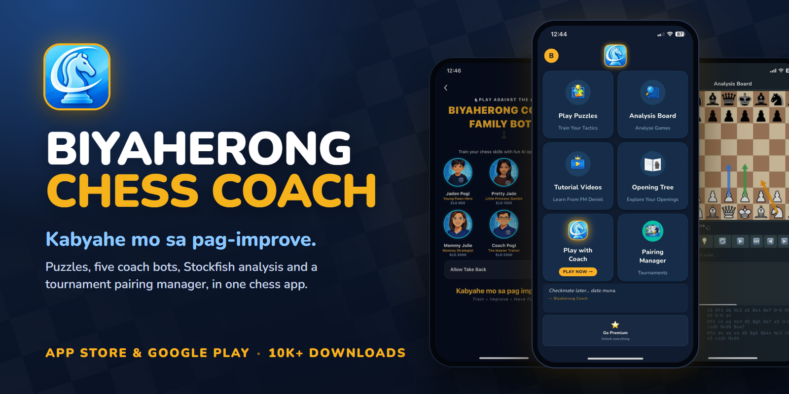

  
  
  
  

<h3 align="center">Chess training for Filipino players, from FIDE Master Deniel Causo.</h3>

  Solve puzzles, play five coach bots, check your games with Stockfish and run your club's tournament, 
  all in one app. Nearly all of it works with no internet at all.

  <a href="https://apps.apple.com/us/app/biyaherong-chess-coach/id6762338466"><b>⬇️ Get it on the App Store</b></a>
  &nbsp;·&nbsp;
  <a href="https://play.google.com/store/apps/details?id=com.prince24pogi.biyaherongchessapp&hl=en"><b>⬇️ Get it on Google Play</b></a>

---

## Why Biyaherong Chess Coach

Most chess apps are built for the whole world. Biyaherong Chess Coach is built around one coach and the players who learn from him: FM Deniel Causo, *Biyaherong Coach*, and his students across the Philippines.

- **Learn from a FIDE Master.** Video lessons from FM Deniel Causo, in Tagalog and English, sorted by topic.
- **Train anywhere, even offline.** Puzzles, games against the coaches, analysis and tournaments all run in Airplane Mode. Only sign-in, the Opening Tree download and the videos need the internet.
- **A real engine in your pocket.** Stockfish 17.1 runs on the phone itself. Your analysis never waits on a server.
- **Made for the club, not just the player.** The Pairing Manager runs a whole Swiss or Round Robin tournament from one phone: pairings, results and standings.

## Screenshots

  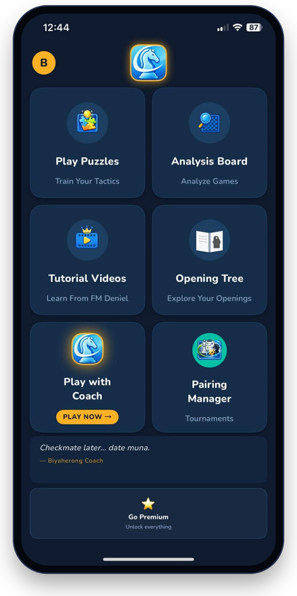
  &nbsp;
  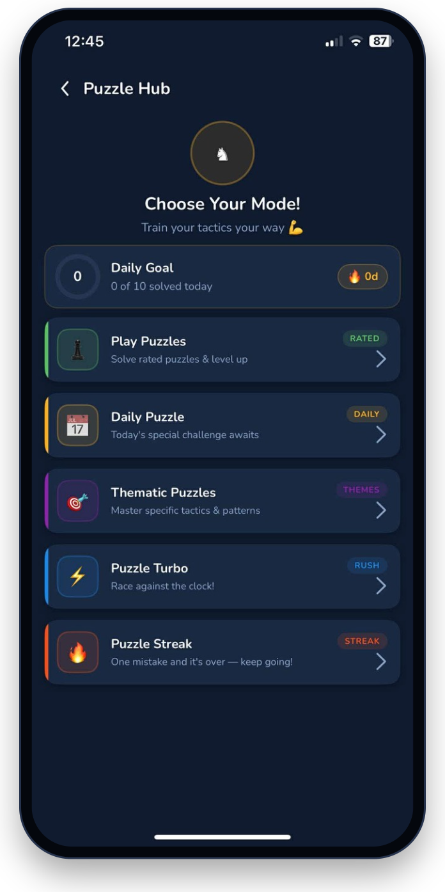
  &nbsp;
  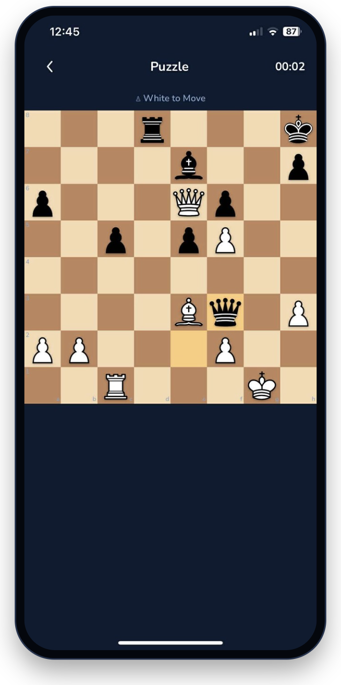

  <b>Home</b>, everything one tap away &nbsp;·&nbsp; <b>Puzzle Hub</b>, five ways to train &nbsp;·&nbsp; <b>Solve</b> against the clock

  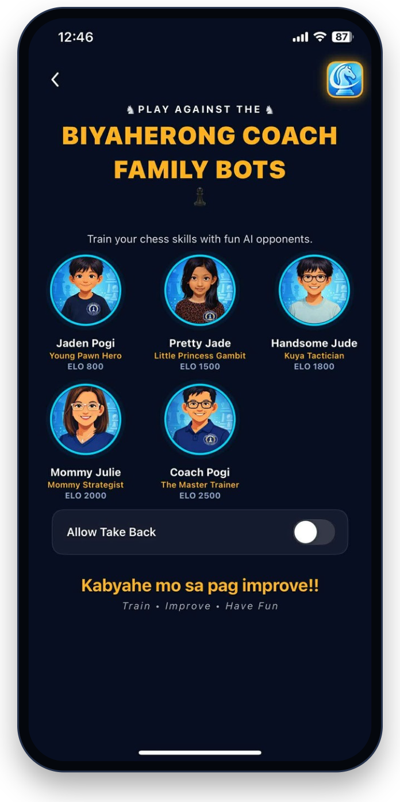
  &nbsp;
  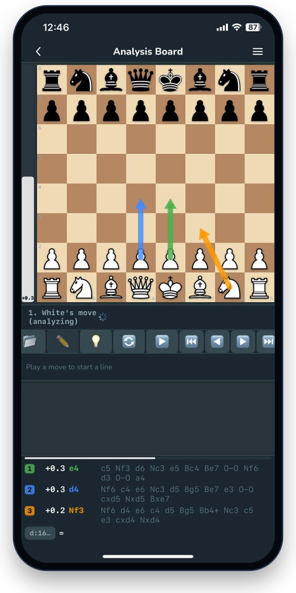
  &nbsp;
  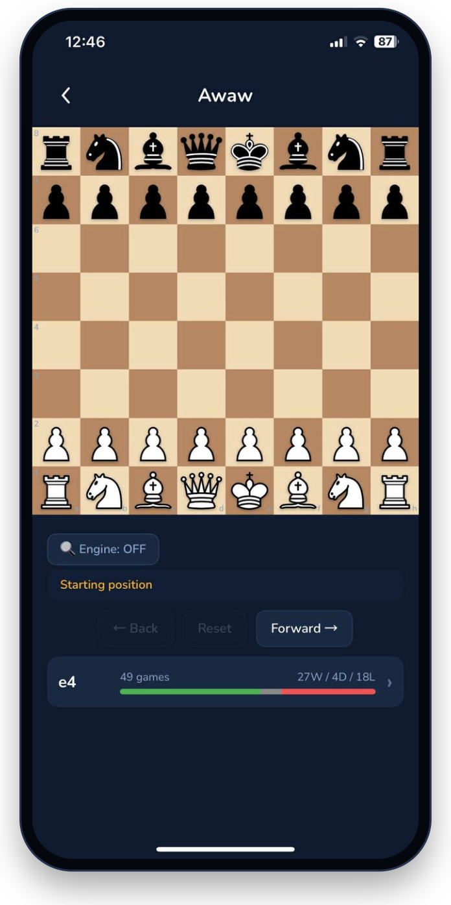

  <b>Coach bots</b>, ELO 800 to 2500 &nbsp;·&nbsp; <b>Analysis Board</b> with Stockfish 17.1 &nbsp;·&nbsp; <b>Opening Tree</b> from your own games

  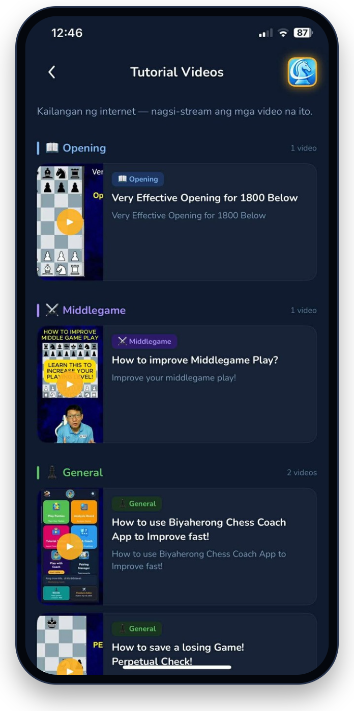
  &nbsp;
  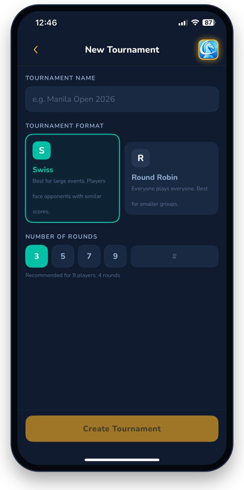
  &nbsp;
  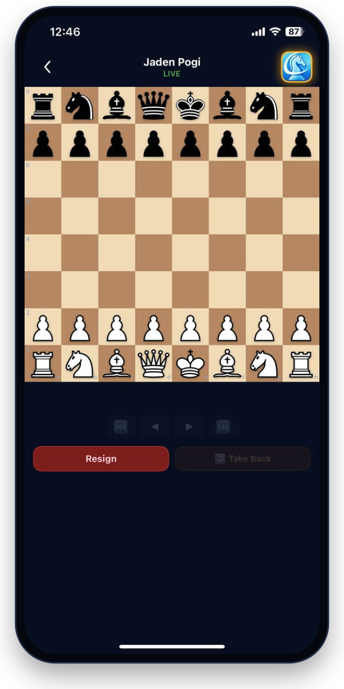

  <b>Tutorial videos</b> from FM Deniel &nbsp;·&nbsp; <b>Pairing Manager</b> for your club &nbsp;·&nbsp; <b>Play</b> a coach, take back if you allow it

## Features

| | |
|---|---|
| 🧩 **Puzzle Hub** | About 93,000 puzzles ship inside the app. Five modes: rated **Play Puzzles**, the **Daily Puzzle**, **Thematic** puzzles by tactic, **Puzzle Turbo** against the clock, and **Puzzle Streak**, where one mistake ends the run. A daily goal of ten keeps the streak alive. |
| 🤖 **Play vs Coach** | The Biyaherong Coach family bots: Jaden Pogi (800), Pretty Jade (1500), Handsome Jude (1800), Mommy Julie (2000) and Coach Pogi (2500). Take-backs are your choice. Leave a game and pick it up later, then review it when it ends. |
| 🔍 **Analysis Board** | Stockfish 17.1 with three ranked lines and arrows on the board, variations, game review with accuracy and an evaluation graph, a position editor, an opening book of 7,854 named openings, and PGN import and export. Free for everyone. |
| 🌳 **Opening Tree** | Bring in your games from Lichess or Chess.com and see the openings you actually play, with the games played and a win, draw and loss bar on every move. |
| 🏆 **Pairing Manager** | Run a Swiss or Round Robin tournament: add players, generate pairings, enter results and share the standings, with Buchholz and Sonneborn-Berger tiebreaks. |
| 🎬 **Tutorial Videos** | Lessons from FM Deniel Causo, sorted by topic: openings, the middlegame and more. |
| 💾 **Saved analyses** | Keep your analysed games in a searchable library, sorted into folders. |
| 📶 **Offline first** | Everything except sign-in, the Opening Tree download and the videos works in Airplane Mode, and keeps working. |

**Plans:** free to download. Premium unlocks everything for **$1.99 a month** or **$19.99 a year** (US prices; Apple sets the local price), both with a **7-day free trial**. The Analysis Board stays free for everyone.

## Under the hood

The first Biyaherong Chess Coach was a **Laravel** backend with a **React Native (Expo)** app, and that app is still the one on Google Play. The iPhone app is a **native Swift rebuild** of it, made to work offline.

- **Swift and SwiftUI**, iOS 17+, with the project generated by XcodeGen and built and shipped to TestFlight by **Codemagic**.
- **A pure-Swift domain layer** ported from the Laravel controllers: puzzle ratings (ELO), streaks, daily limits, game review, and Swiss and Round Robin pairing with tiebreaks.
- **Parity-tested against the original backend.** The real PHP code generates golden test vectors, and the Swift has to match them exactly: thousands of randomised cases, including 3,000 rating updates and 270 full randomised tournaments.
- **Move generation verified by perft**, for example 197,281 positions from the start at depth 4.
- **Mutation testing** injects 41 deliberate bugs, and the suite catches 40. The one survivor is provably equivalent to the original.
- **Stockfish 17.1 compiled into the app** through a C++ bridge, with its NNUE networks, and a hand-written search as the fallback.
- **Subscriptions with no server.** StoreKit 2 checks Apple's signed transactions on the device, so they work in Airplane Mode too, with a grace window for renewals the phone has not seen yet.
- **The puzzle bank is built deterministically** from 550,000 Lichess puzzles into one SQLite file of about 93,000.
- **All networking lives in two files**, and a check fails if a third one appears.

  
  
  
  
  
  
  
  

## FAQ

<b>Is it free?</b>

 
It is free to download, and the Analysis Board is free for everyone. Everything else is part of Premium, which starts with a 7-day free trial.

<b>Does it need the internet?</b>

 
Only for signing in, downloading your games into the Opening Tree, and watching the tutorial videos. Puzzles, coach games, analysis and tournaments all work offline.

<b>Which phones does it run on?</b>

 
iPhones on iOS 17 or newer, from the App Store, and Android phones from Google Play.

## Want an app like this?

Biyaherong Chess Coach was built for one coach and his students. The same can be built for **you**:

- **Chess coaches, clubs and academies**, with your name, your lessons and your players
- **Any coaching or training business** that wants its own app on the App Store and Google Play
- **Web, iOS and Android**, from the backend to the store listing

Send a message, and say what you have in mind:

  
  
  

## Made by

<table>
  <tr>
    <td>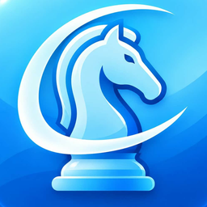</td>
    <td>
      <b>Prince E. Sanguan</b> · AI Full Stack Engineer · Silang, Cavite, Philippines 
      Builds production software end to end, from databases and AI pipelines to web and native mobile apps. 
      <a href="https://psanguan.com">psanguan.com</a> · <a href="https://www.linkedin.com/in/prince-sanguan-a78988274/">LinkedIn</a> · <a href="mailto:princesanguan44@gmail.com">princesanguan44@gmail.com</a>
    </td>
  </tr>
</table>

Built for **FM Deniel Causo**, the coach behind Biyaherong Chess Coach.

**Also by Prince:** [*Kara-okay*](https://github.com/PrinceSanguan/KARA-OKAY), the Filipino videoke night on your Android phone.

## Credits and notices

Biyaherong Chess Coach is built on these open projects and assets:

- [Stockfish](https://stockfishchess.org) 17.1, by the Stockfish developers, under the GNU GPL v3. It is compiled into the iPhone app, which is released under the same licence.
- Chess piece artwork by Uray M. János, from the Wikipedia chess set, under CC BY-SA.
- [Lichess puzzle database](https://database.lichess.org/#puzzles) and [lichess-org/chess-openings](https://github.com/lichess-org/chess-openings), both under CC0.
- [Nunito](https://github.com/googlefonts/nunito), under the SIL Open Font License 1.1.

Lichess and Chess.com are the property of their owners and are not connected with this app.

   
  Made in the Philippines 🇵🇭 by Prince E. Sanguan, for Biyaherong Chess Coach

